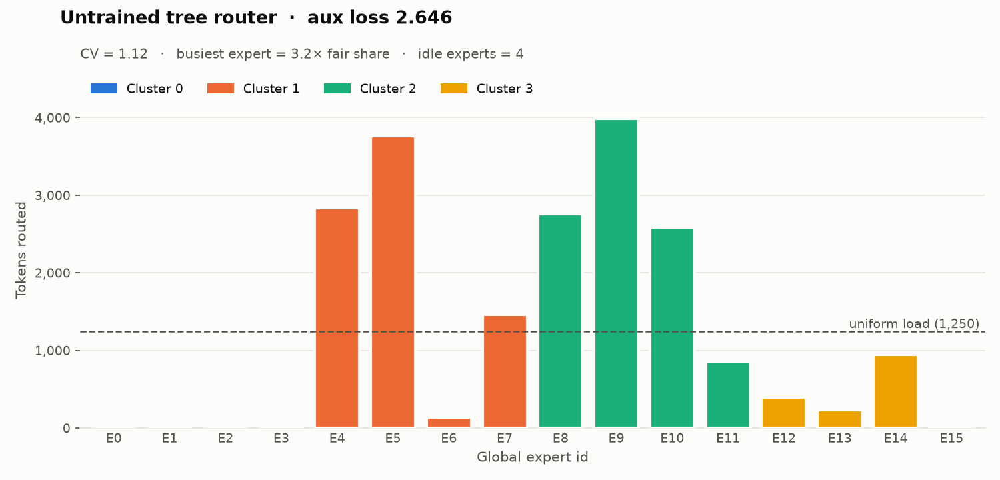
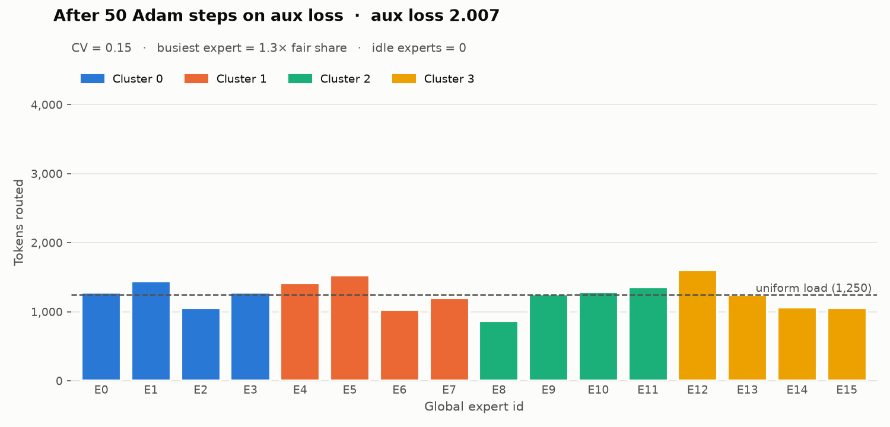

# tree-moe-router-pytorch

A compact, tested PyTorch implementation of a **2-level hierarchical (tree) Mixture-of-Experts router**. Each token is first routed to a **cluster**, then to an **expert inside that cluster**. A load-balancing loss at both levels keeps all experts in use.

## Overview

A sparse MoE layer replaces one dense feed-forward block with $N$ expert FFNs and a router that sends each token to a few of them. The standard (flat) router scores **all** $N$ experts for every token. A **tree router** factorises the decision:

1. **Level 1:** choose one of $C$ clusters.
2. **Level 2:** choose one of the $E$ experts in that cluster.

This gives $N = C \cdot E$ experts while each token only evaluates $C + E$ gate logits. The hierarchy also gives experts a natural grouping, so a cluster can live on a single device or node for locality-aware expert parallelism.

| Component | File | Description |
|---|---|---|
| `Expert` | [src/experts.py](src/experts.py) | FFN expert, SwiGLU (default) or GELU |
| `TreeRouter` | [src/router_tree.py](src/router_tree.py) | Cluster gate + per-cluster expert gates + two-level aux loss |
| `TreeMoELayer` | [src/moe_layer.py](src/moe_layer.py) | Router + `C·E` experts with sort-based token dispatch |

## Architecture Diagram

```text
                         x  ∈ ℝ^{B×S×d}
                               │
               ┌───────────────▼────────────────┐
     Level 1   │  cluster_gate: Linear(d → C)   │   P(c | x) = softmax(W_c x)
               └───────────────┬────────────────┘
                     top-1 cluster c* (+ weight P(c*|x))
        ┌──────────────┬───────┴──────┬──────────────┐
        ▼              ▼              ▼              ▼
  ┌───────────┐  ┌───────────┐  ┌───────────┐  ┌───────────┐
  │ gate₀:d→E │  │ gate₁:d→E │  │ gate₂:d→E │  │ gate₃:d→E │   Level 2: P(e | x, c*)
  └─────┬─────┘  └─────┬─────┘  └─────┬─────┘  └─────┬─────┘
   E0 E1 E2 E3    E4 E5 E6 E7    E8 E9 E10 E11  E12 E13 E14 E15   ← experts (FFNs)
        └──────────────┴───────┬──────┴──────────────┘
                               ▼
            y = P(c*|x) · P(e*|x,c*) · Expert_{c*·E + e*}(x)
```

## Mathematical Formulation

### Dense (flat) MoE routing

For a token $x \in \mathbb{R}^d$ and $N$ experts with router weights $W \in \mathbb{R}^{N \times d}$:

```math
p_i(x) = \frac{\exp(w_i^\top x)}{\sum_{j=1}^{N} \exp(w_j^\top x)}, \qquad
i^* = \arg\max_i \, p_i(x), \qquad
y = p_{i^*}(x)\, \mathrm{FFN}_{i^*}(x).
```

Routing costs $\mathcal{O}(N d)$ per token, and a single softmax competes across all $N$ experts.

### Hierarchical (tree) routing

With $C$ clusters of $E$ experts each ($N = C E$), cluster gate $W^{(1)} \in \mathbb{R}^{C \times d}$ and one expert gate $W^{(2,c)} \in \mathbb{R}^{E \times d}$ per cluster:

```math
P(c \mid x) = \mathrm{softmax}\big(W^{(1)} x\big)_c, \qquad c^* = \arg\max_c P(c \mid x)
```

```math
P(e \mid x, c^*) = \mathrm{softmax}\big(W^{(2,c^*)} x\big)_e, \qquad e^* = \arg\max_e P(e \mid x, c^*)
```

The final gate is the probability of the path through the tree:

```math
P(\text{expert} = c^* E + e^* \mid x) = P(c^* \mid x) \cdot P(e^* \mid x, c^*),
\qquad
y = P(c^* \mid x)\, P(e^* \mid x, c^*)\; \mathrm{FFN}_{c^* E + e^*}(x).
```

Each token computes only $C + E$ logits, i.e. $\mathcal{O}((C+E) d)$ instead of $\mathcal{O}(C E d)$. For $C = E = 64$ that is 128 logits instead of 4,096.

### Auxiliary load-balancing loss

Without regularisation, routers collapse: a few experts get most tokens, and the rest receive no gradient. Following the Switch Transformer, for a set of $T$ tokens and $N$ choices:

```math
\mathcal{L}_{\text{aux}} = N \sum_{i=1}^{N} f_i \, P_i,
\qquad
f_i = \frac{1}{T}\sum_{t=1}^{T} \mathbb{1}\!\left[\arg\max_j p_j(x_t) = i\right],
\qquad
P_i = \frac{1}{T}\sum_{t=1}^{T} p_i(x_t).
```

$`f_i`$ is the hard dispatch fraction (not differentiable); gradients flow through $`P_i`$. The loss equals $1$ under perfectly uniform routing and $N$ under full collapse.

It is applied at **both levels**:

```math
\mathcal{L}_{\text{cluster}} = C \sum_{c=1}^{C} f_c P_c
\qquad\text{(over all } T \text{ tokens)}
```

```math
\mathcal{L}_{\text{expert}} = \sum_{c=1}^{C} \frac{T_c}{T}\; E \sum_{e=1}^{E} f_{e \mid c}\, P_{e \mid c}
\qquad\text{(over the } T_c \text{ tokens routed to cluster } c\text{)}
```

```math
\mathcal{L}_{\text{aux}}^{\text{tree}} = \lambda_{c}\,\mathcal{L}_{\text{cluster}} + \lambda_{e}\,\mathcal{L}_{\text{expert}}
```

Weighting each cluster's expert-level loss by its token share $`T_c / T`$ keeps $`\mathcal{L}_{\text{expert}}`$ at $1$ under perfect balance. With the default $`\lambda_c = \lambda_e = 1`$, the optimum of $`\mathcal{L}_{\text{aux}}^{\text{tree}}`$ is therefore $2$.

## Installation

```bash
git clone https://github.com/dio-proxy/tree-moe-router-pytorch.git
cd tree-moe-router-pytorch
python -m venv .venv && source .venv/bin/activate
pip install -r requirements.txt
```

Requires Python ≥ 3.9 and PyTorch ≥ 2.1.

## Quick Start Code

```python
import torch
from src import TreeMoELayer

layer = TreeMoELayer(
    hidden_dim=512,
    intermediate_dim=2048,
    num_clusters=4,
    experts_per_cluster=4,      # 16 experts total
    activation="swiglu",
)

x = torch.randn(8, 128, 512)   # [batch, seq_len, hidden_dim]
y, aux_loss = layer(x)          # y: [8, 128, 512], aux_loss: scalar

task_loss = y.pow(2).mean()     # stand-in for your model's loss
loss = task_loss + 0.01 * aux_loss
loss.backward()

# Inspect routing directly
expert_ids, weights, _ = layer.router(x)   # [8, 128] each
print(layer.expert_load(x))                # tokens per expert, shape [16]
```

In a full model, add `aux_coef * aux_loss` (typically `1e-2`) from every MoE layer to the task loss.

## Benchmarks / Visuals

Run the tests and regenerate the charts:

```bash
pytest -q                          # 11 tests: shapes, aux loss, gradients, routing logic
python tests/plot_distribution.py  # writes assets/distribution_{untrained,trained}.png
```

`plot_distribution.py` builds a 4 × 4 tree (16 experts), routes 20,000 synthetic tokens, then optimises **only** the auxiliary loss with Adam (lr `1e-2`, 50 steps × 4,096 tokens) and routes 20,000 fresh tokens. The synthetic tokens share a common mean direction, like real hidden states, which is what skews an untrained router.

| | Untrained | After 50 steps |
|---|---|---|
| Aux loss (optimum = 2.0) | 2.646 | 2.007 |
| Load coefficient of variation | 1.12 | 0.15 |
| Busiest expert vs. fair share | 3.2× | 1.3× |
| Idle experts | 4 / 16 | 0 / 16 |





Before training, cluster 0 receives no tokens, so all four of its experts are idle. After 50 steps every expert receives between 0.7× and 1.3× its fair share.

> **Note on optimisation.** When the aux loss is optimised *in isolation* with a large learning rate (≥ `3e-2` in this setup), the router can overshoot: tokens that share a dominant direction flip experts together, and the softmax saturates onto a single expert, where the gradient vanishes. In real training the aux loss is a small term (`~1e-2 ×`) next to the task loss, so this does not occur at normal settings. Still, keep the router learning rate modest and monitor `layer.expert_load(...)`.

## Design notes

- **Top-1 at both levels.** This is the simplest form of the tree. Top-k clusters or experts are a straightforward extension in `TreeRouter.forward`.
- **Router math in fp32.** Softmaxes are computed in float32 and cast back, which is safe under bf16/fp16 autocast.
- **Sort-based dispatch.** `TreeMoELayer` sorts tokens by expert id once and runs each expert on a contiguous slice, instead of building one boolean mask per expert.
- **No capacity factor.** Every token is processed (no dropping). Add a capacity limit per expert if you need static shapes for expert parallelism.

## Project structure

```text
tree-moe-router-pytorch/
├── requirements.txt
├── README.md
├── conftest.py             # puts the repo root on sys.path for pytest
├── assets/                 # generated charts
├── src/
│   ├── __init__.py
│   ├── experts.py
│   ├── router_tree.py
│   └── moe_layer.py
└── tests/
    ├── test_routing.py
    └── plot_distribution.py
```

## References

- Shazeer et al., *Outrageously Large Neural Networks: The Sparsely-Gated Mixture-of-Experts Layer*, 2017. (The hierarchical MoE in its appendix inspired this design.)
- Fedus, Zoph & Shazeer, *Switch Transformers: Scaling to Trillion Parameter Models with Simple and Efficient Sparsity*, 2021.
- Shazeer, *GLU Variants Improve Transformer*, 2020.
